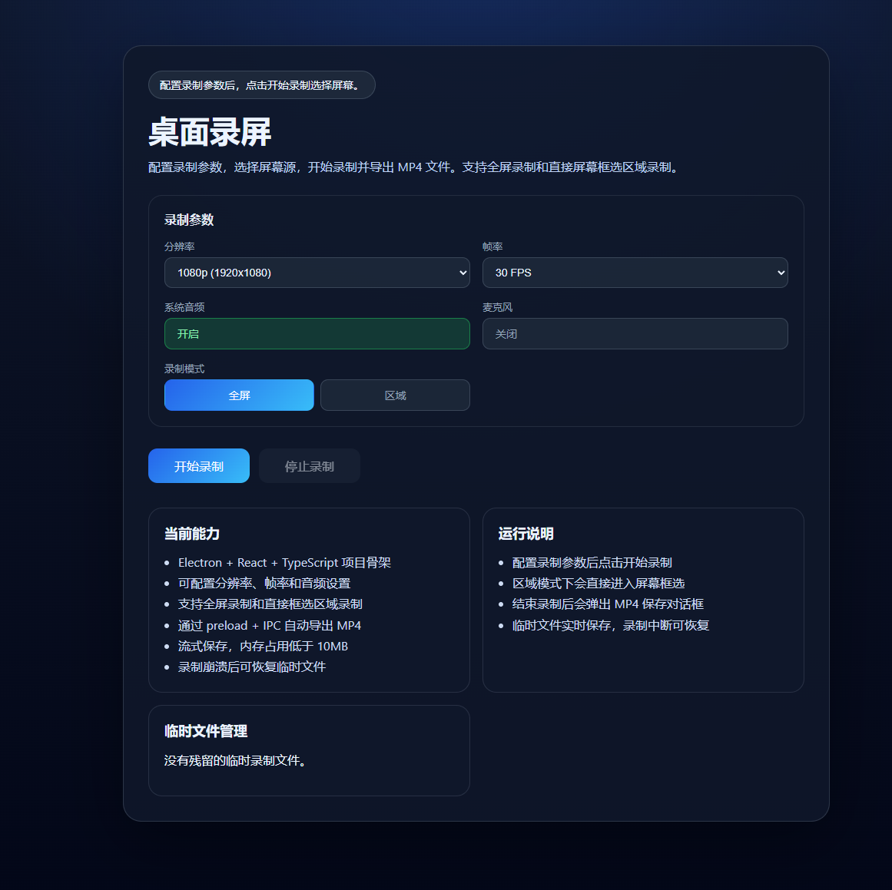

# RecDesk

一款基于 Electron 的桌面屏幕录制应用，支持全屏录制和区域选择录制，输出 MP4 格式视频文件。



[English Documentation](README_EN.md)

## 功能特性

- **全屏录制** - 录制整个桌面屏幕内容
- **区域选择录制** - 直接在屏幕上拖动框选录制区域
- **动态分辨率** - 根据系统分辨率自动生成可用选项（4K/2K/1080p/720p/480p）
- **帧率配置** - 支持 60/30/24/15 FPS
- **音频录制** - 可选系统音频和麦克风输入
- **实时录制指示器** - 显示录制状态和时长
- **自动转换** - 使用 FFmpeg 将 WebM 转换为 MP4
- **崩溃恢复** - 录制中断时可恢复未保存的录制文件

## 技术栈

- **Electron** - 跨平台桌面应用框架
- **React 19** - UI 组件库
- **TypeScript** - 类型安全
- **electron-vite** - 构建工具
- **FFmpeg** - 视频转码

## 快速开始

### 系统要求

- Node.js 18+
- npm 9+
- Windows 10/11（当前仅支持 Windows）

### 安装依赖

```bash
npm install
```

### 开发运行

```bash
npm run dev
```

### 构建打包

```bash
# 编译源代码
npm run build

# 打包为可执行程序（Windows）
npm run build:win
```

打包输出位于 `dist/win-unpacked/` 目录。

### 预览构建结果

```bash
npm run preview
```

## 项目结构

```
src/
├── main/           # Electron 主进程
│   └── index.ts    # 窗口管理、IPC、FFmpeg 转换
├── preload/        # 预加载脚本
│   ├── index.ts    # contextBridge API
│   └── global.d.ts # 全局类型声明
└── renderer/       # 渲染进程（React）
    ├── index.html
    └── src/
        ├── App.tsx                # 主界面
        ├── RegionSelectionOverlay.tsx  # 区域选择覆盖层
        ├── RecordingIndicatorOverlay.tsx # 录制指示器
        └── styles.css             # 样式
```

## 命令说明

| 命令 | 说明 |
|------|------|
| `npm run dev` | 启动开发模式 |
| `npm run build` | 编译 main/preload/renderer |
| `npm run build:win` | 编译并打包 Windows 可执行程序 |
| `npm run preview` | 预览构建结果 |
| `npm run typecheck` | TypeScript 类型检查 |

## License

[MIT](LICENSE)

## 致谢

- [electron-vite](https://github.com/alex8088/electron-vite)
- [ffmpeg-static](https://github.com/eugeneware/ffmpeg-static)
- [React](https://react.dev/)