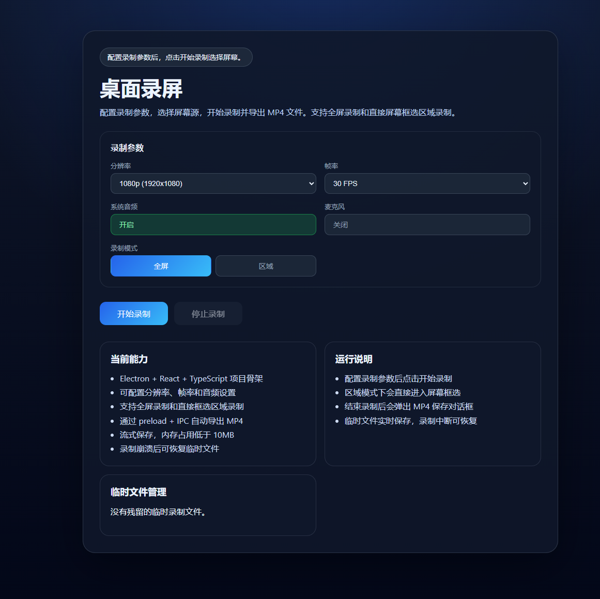

# RecDesk

## Native C++ version

A separate Windows C++20 / Win32 / WASAPI implementation now lives in `native/`.
It encodes H.264/AAC to a recoverable MKV while recording, then remuxes to MP4 without video re-encoding.
Failed or cancelled exports preserve the recording source. No Electron, Node.js, or Qt runtime is required.

Build from the repository root with `powershell -NoProfile -ExecutionPolicy Bypass -File native\build.ps1`, then run `native\release\RecDesk.exe`.
See `native/README.md` for requirements, recovery, tests, and current limitations. The original Electron application is preserved; the documentation below describes that version.

A desktop screen recording application built with Electron. Supports full-screen and region selection recording, exports MP4 video files.



[中文文档](README.md)

## Features

- **Full-screen Recording** - Capture entire desktop screen
- **Region Selection Recording** - Drag to select recording area directly on screen
- **Dynamic Resolution** - Auto-generates available options based on system resolution (4K/2K/1080p/720p/480p)
- **Frame Rate Configuration** - Supports 60/30/24/15 FPS
- **Audio Recording** - Optional system audio and microphone input
- **Real-time Recording Indicator** - Shows recording status and duration
- **Auto Conversion** - Converts WebM to MP4 using FFmpeg
- **Crash Recovery** - Recover unsaved recordings after interruption

## Tech Stack

- **Electron** - Cross-platform desktop framework
- **React 19** - UI component library
- **TypeScript** - Type safety
- **electron-vite** - Build tool
- **FFmpeg** - Video transcoding

## Quick Start

### Requirements

- Node.js 18+
- npm 9+
- Windows 10/11 (currently Windows only)

### Install Dependencies

```bash
npm install
```

### Development

```bash
npm run dev
```

### Build

```bash
# Compile source code
npm run build

# Package as executable (Windows)
npm run build:win
```

> The build process downloads Electron and dependencies. Using a global proxy is recommended to speed up downloads.

Output located in `dist/win-unpacked/` directory.

### Preview Build

```bash
npm run preview
```

## Project Structure

```
src/
├── main/           # Electron main process
│   └── index.ts    # Window management, IPC, FFmpeg conversion
├── preload/        # Preload script
│   ├── index.ts    # contextBridge API
│   └── global.d.ts # Global type declarations
└── renderer/       # Renderer process (React)
    ├── index.html
    └── src/
        ├── App.tsx                # Main UI
        ├── RegionSelectionOverlay.tsx  # Region selection overlay
        ├── RecordingIndicatorOverlay.tsx # Recording indicator
        └── styles.css             # Styles
```

## Commands

| Command | Description |
|---------|-------------|
| `npm run dev` | Start development mode |
| `npm run build` | Compile main/preload/renderer |
| `npm run build:win` | Compile and package Windows executable |
| `npm run preview` | Preview build result |
| `npm run typecheck` | TypeScript type check |

## License

[MIT](LICENSE)

## Acknowledgments

- [electron-vite](https://github.com/alex8088/electron-vite)
- [ffmpeg-static](https://github.com/eugeneware/ffmpeg-static)
- [React](https://react.dev/)
